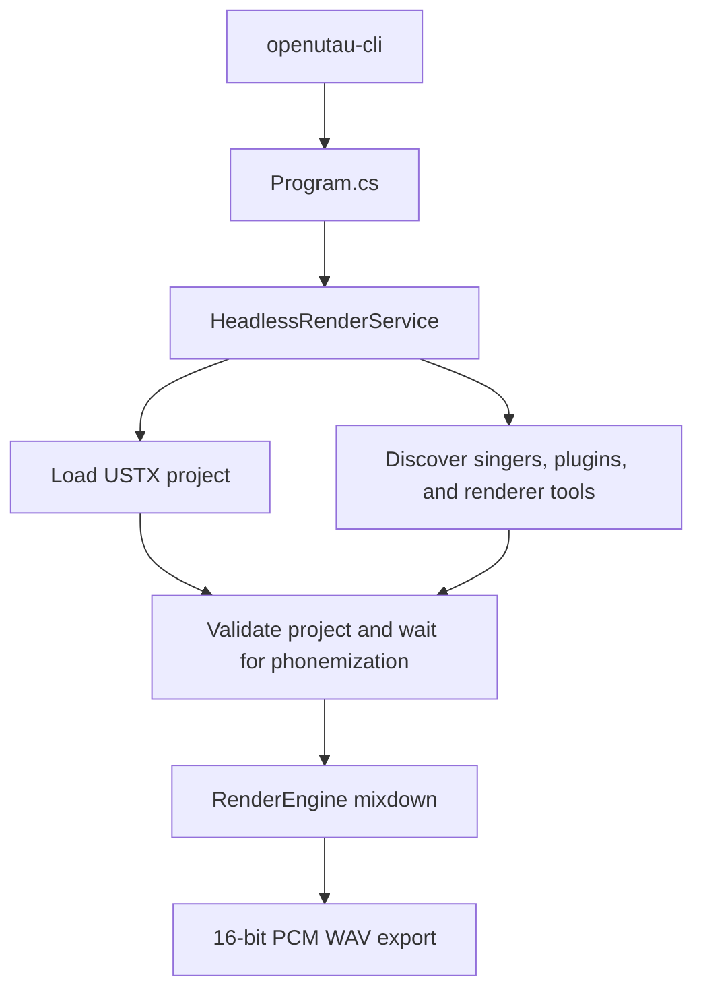

# OpenUtau-CLI

OpenUtau-CLI is a headless command-line renderer for
[OpenUtau](https://github.com/stakira/OpenUtau) projects. Its primary command
loads an existing `.ustx` project, runs OpenUtau's singer and phonemizer
pipeline, renders the complete project mix, and writes a WAV file without
launching the Avalonia desktop application:

```sh
openutau-cli render input.ustx --out output.wav
```

This repository is a fork of the OpenUtau desktop application. It retains the
desktop projects and rendering engine, but adds `OpenUtau.Cli` and a reusable
headless render service as the main entry point for automation, batch jobs, and
server-side workflows. The goal is compatibility with projects and resources
prepared in OpenUtau, not a separate UTAU implementation.

## Current CLI scope

The implemented command is:

```text
openutau-cli render <input.ustx> --out <output.wav>
```

The command:

- accepts one USTX input and one WAV output;
- does not open or initialize the desktop UI;
- loads the project's voice and wave parts;
- discovers installed singers, phonemizers, resamplers, and wavtools;
- waits for asynchronous phonemization to finish;
- validates the singers, phonemizers, and renderers used by voice parts;
- renders through OpenUtau's existing `RenderEngine`; and
- writes a 44.1 kHz, stereo, 16-bit WAV mixdown.

The CLI does not currently edit projects, install singers or dependencies,
choose render components with command-line flags, or export separate track
files. Configure the project in OpenUtau before rendering it.

## Prerequisites

To build and run from source, install the .NET 8 SDK.

Rendering also requires the resources referenced by the project to already be
available:

- Every voice track used by a voice part must reference an installed singer.
- Singer voicebank files and any singer-specific models or resources must be
  complete and loadable.
- External phonemizer assemblies used by the project must be installed in the
  OpenUtau `Plugins` directory. Built-in phonemizers are provided by
  `OpenUtau.Plugin.Builtin.dll`, which is copied with the CLI build.
- Projects using the Classic renderer may use the built-in WORLDLINE resampler
  and Sharp wavtool. Any explicitly selected external resampler or wavtool must
  be installed in the OpenUtau `Resamplers` or `Wavtools` directory and must be
  executable on the host platform. On non-Windows systems, Windows `.exe` or
  `.bat` tools are discovered only when a Wine path is configured.
- Neural or service-backed singers may require their normal OpenUtau packages,
  models, dependencies, or services. The CLI reuses those renderers; it does
  not download their requirements.

The output directory must already exist. The CLI validates the input and output
filename extensions, resolves both paths to absolute paths, and reports a
missing input file or output directory as a render failure.

## Build

From the repository root, restore and build the CLI project:

```sh
dotnet restore OpenUtau.Cli/OpenUtau.Cli.csproj
dotnet build OpenUtau.Cli/OpenUtau.Cli.csproj --configuration Release --no-restore
```

The framework-dependent executable is produced under:

```text
OpenUtau.Cli/bin/Release/net8.0/
```

The solution also includes the desktop application and tests. To build
everything:

```sh
dotnet build OpenUtau.sln --configuration Release
```

## Testing

Run the full test project for CLI tests and broader OpenUtau coverage:

```sh
dotnet test OpenUtau.Test/OpenUtau.Test.csproj --no-restore
```

Run the CLI argument parsing and validation tests:

```sh
dotnet test OpenUtau.Test/OpenUtau.Test.csproj --no-restore \
  --filter "FullyQualifiedName~OpenUtau.Test.Cli.RenderArgumentsTest"
```

Run the headless rendering service behavior tests:

```sh
dotnet test OpenUtau.Test/OpenUtau.Test.csproj --no-restore \
  --filter "FullyQualifiedName~OpenUtau.Core.Headless.HeadlessRenderServiceTest"
```

## Render a USTX project

Run directly from source:

```sh
dotnet run --project OpenUtau.Cli/OpenUtau.Cli.csproj -- \
  render /path/to/song.ustx --out /path/to/song.wav
```

Or run the built executable:

```sh
./OpenUtau.Cli/bin/Release/net8.0/openutau-cli \
  render /path/to/song.ustx --out /path/to/song.wav
```

On Windows, use `openutau-cli.exe`.

Show the supported syntax with:

```sh
openutau-cli --help
```

Arguments are intentionally strict. `--out` must follow the input path, the
input name must end in `.ustx`, the output name must end in `.wav`, and extra
arguments are rejected. Extension checks are case-insensitive.

## Errors and cancellation

| Code | Meaning |
| ---: | --- |
| `0` | Help was shown or rendering completed successfully. |
| `1` | The command or arguments were invalid. Usage is written to standard error. |
| `2` | Loading, validation, rendering, or WAV export failed. |

An invalid or missing command, malformed option sequence, wrong input or output
extension, or unexpected extra argument exits with code `1`. The input must end
in `.ustx`, the output must end in `.wav`, and `--out` must appear between them.
The CLI writes the specific error and usage text to standard error.

After argument parsing, failures exit with code `2`. These include a missing
input file, missing output directory, malformed or unreadable USTX, a missing
or unloaded singer, phonemizer failure, an unavailable renderer, rendering
failure, and a WAV or output-write failure. Render failures are written to
standard error as `Error: ...`, followed by the immediate underlying exception
message when one is available. The service does not explicitly remove a
partially written output file after a write failure.

`HeadlessRenderService.RenderMixdownAsync()` accepts a .NET
`CancellationToken`. Cancellation is checked before loading and exporting,
while waiting for the process-wide render lock and phonemization, and by the
render engine through a linked token. Cancellation is rethrown rather than
wrapped as a render failure. The current executable does not pass a token to
the service or install a dedicated Ctrl+C handler, so it does not provide a
graceful Ctrl+C cancellation path.

## How project settings are selected

The CLI has no singer, phonemizer, renderer, resampler, or wavtool flags.
Selection is driven by the USTX and the same preferences used by OpenUtau.

For example, a USTX track can serialize a DiffSinger configuration as:

```yaml
tracks:
- singer: TIGER_DS_v102
  phonemizer: OpenUtau.Core.DiffSinger.DiffSingerARPAPlusEnglishPhonemizer
  renderer_settings:
    renderer: DIFFSINGER
```

This is only an example; `TIGER_DS_v102` is not universally required. The
singer, phonemizer, and renderer values are stored in the USTX project rather
than selected with CLI flags, and the referenced singer, plugin, model, and
renderer resources must be available locally.

### Singer

Each track stores a singer ID. During USTX loading, that ID is resolved against
the discovered singers. Rendering fails before `RenderEngine` is invoked if a
voice part uses a track whose singer is missing or failed to load. The error
includes the singer ID, track number, and searched singer directories.

### Phonemizer and plugins

Each track stores the fully qualified type name of its phonemizer. At startup,
the runtime loads:

1. `OpenUtau.Plugin.Builtin.dll` beside the CLI executable;
2. managed phonemizer assemblies found recursively under the user-data
   `Plugins` directory; and
3. phonemizers exported by `OpenUtau.Core`.

The stored type is then instantiated. If it cannot be resolved, the existing
track-loading behavior falls back to OpenUtau's default phonemizer. The
headless service runs full project validation, waits until all voice parts
report current phonemes, and fails if phonemization produced an error.

### Renderer, resampler, and wavtool

Each track's serialized render settings are validated after its singer is
resolved:

- If a renderer is stored, OpenUtau creates that renderer.
- If no renderer is stored, the default is selected from the singer type and
  preferences. Classic singers default to WORLDLINE-R unless the shared
  preference selects Classic. ENUNU, VOGEN, DiffSinger, and Voicevox singers
  select their corresponding renderer.
- An unknown or unavailable renderer causes headless validation to fail.
- For the Classic renderer, stored or preferred resampler and wavtool names are
  resolved from discovered tools. If a named tool is unavailable, existing
  OpenUtau behavior falls back to the built-in WORLDLINE resampler and Sharp
  wavtool.

Renderer expressions saved in the project, including per-phoneme resampler
engine selection, continue to be handled by the core rendering pipeline.

## DiffSinger note grouping

OpenUtau groups a following note whose lyric begins with `+` with the preceding
lyrical note only when the two notes are exactly contiguous. Chained contiguous
`+` notes remain attached to the same lyrical note. For example:

```yaml
notes:
- lyric: "Glory"
- lyric: "+"
```

`MachineLearningPhonemizer` receives the lyrical note and its attached slur
notes as one `Note[]` group. DiffSinger performs G2P using the complete lyric
from the first note, then `ProcessWord()` distributes the resulting phonemes
across the note group.

A plain `+` note remains available as another vowel or syllable-start position.
Notes beginning with `+~` or `+*` are vowel-extension notes, so DiffSinger
excludes them from new vowel-start positions. In
`DiffSingerARPAPlusEnglishPhonemizer`, a lyric exactly equal to `-` maps
directly to the `SP` phoneme.

## Current limitations

- `render` is the only implemented command, with USTX input and WAV output.
- The CLI does not edit projects, interactively select singers, or expose
  singer, phonemizer, or renderer selection flags.
- There is no CLI command for separate per-track export.
- Referenced singers, plugins, models, renderer dependencies, resamplers, and
  wavtools must already be available locally.
- The executable does not wire Ctrl+C to a `CancellationToken`.

## OpenUtau user-data locations

The CLI deliberately uses OpenUtau's existing user-data and preference layout
so it can find singers and configuration installed for the desktop
application.

| Platform | Data directory | Cache directory |
| --- | --- | --- |
| Linux | `$XDG_DATA_HOME/OpenUtau`, or `~/.local/share/OpenUtau` when `XDG_DATA_HOME` is unset | `$XDG_CACHE_HOME/OpenUtau`, or `~/.cache/OpenUtau` when `XDG_CACHE_HOME` is unset |
| macOS | `~/Library/OpenUtau` | `~/Library/Caches/OpenUtau` |
| Windows installed mode | `Documents/OpenUtau` when `installed.txt` exists beside the executable | `Documents/OpenUtau/Cache` |
| Windows portable mode | The directory containing the executable | `<executable directory>/Cache` |

Important subdirectories under the data directory are:

```text
Singers/
Content/Singers/    # legacy location, when present
Plugins/
Resamplers/
Wavtools/
Dependencies/
prefs.json
```

Singer discovery searches `Singers`, the legacy `Content/Singers` directory
when it exists, and the configured `AdditionalSingerPath` from `prefs.json`
when that directory exists. Other values in `prefs.json`, including the
default renderer, Classic resampler and wavtool defaults, Wine path, and muted
track rendering preference, are also shared with the desktop application.

On Windows, a locally built CLI normally runs in portable mode unless an
`installed.txt` marker is placed beside that executable. Consequently, a build
under `OpenUtau.Cli/bin/...` will use that output directory as its data
directory rather than automatically using `Documents/OpenUtau`.

## Rendering pipeline



For developers integrating the headless service, the current flow is:

1. Initialize code-page support, renderer tools, singer discovery, built-in and
   external phonemizer plugins, and a dedicated single-thread scheduler.
2. Detect and deserialize the USTX with `Formats.ReadProject` without starting
   validation during deserialization.
3. Publish the loaded project to `DocManager`, run `ValidateFull`, and wait for
   every voice part's asynchronous phonemizer response.
4. Reject missing or unloaded singers, missing phonemizers, unavailable
   renderers, and phonemizer errors.
5. Invoke `RenderEngine.RenderMixdown` in blocking export mode.
6. Mix rendered voice parts and loaded wave parts with track volume, pan, and
   mute state, then export through NAudio's 16-bit WAV writer.

Rendering is serialized within the process because OpenUtau's managers,
preferences, project state, and plugin registries are shared singletons.

## Architecture and background documentation

This README documents the current CLI operation.
[HEADLESS_CLI_RENDERER.md](HEADLESS_CLI_RENDERER.md) records the original
headless extraction and design rationale. It is historical planning material
and contains proposed implementation steps, including an unwired render
command and a future headless service, that have since been completed.

## Upstream OpenUtau desktop application

OpenUtau is a free, open-source singing voice editor for the UTAU community.
This fork keeps the upstream desktop application available, but desktop usage,
downloads, editor documentation, and community support remain documented by
the [OpenUtau project](https://github.com/stakira/OpenUtau) and its
[Getting Started wiki](https://github.com/stakira/OpenUtau/wiki/Getting-Started).

Plugin API documentation retained in this repository:

- [Editing Macros API](OpenUtau.Core/Editing/README.md)
- [Phonemizers API](OpenUtau.Core/Api/README.md)
